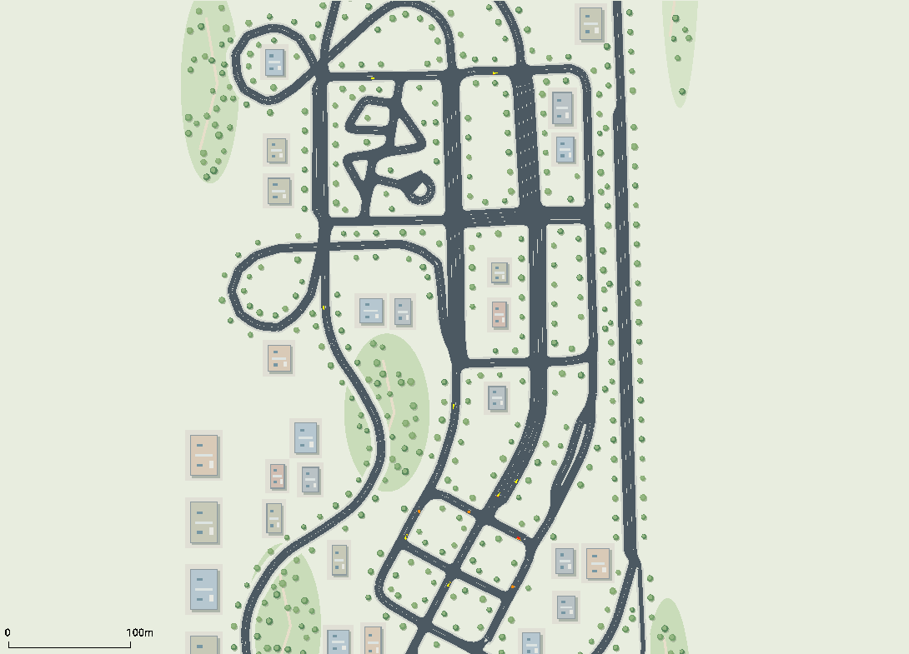

# K-CITY 자율주행 의사결정 프로젝트

**K-CITY를 도로 레퍼런스로 삼아, SUMO에서 교통 환경을 구축하고 자율주행 의사결정 모델을 학습·평가하는 프로젝트입니다.**

기존 「자율주행 인공지능 및 제어」 수업 예제 저장소를 **K-CITY 프로젝트 개발용 저장소로 재구성**했습니다. 앞으로 도로와 교통 시나리오, 자율주행 차량(AV) 환경, BC·PPO 학습, 주행 데이터 수집과 평가를 이 저장소에서 이어갑니다. 기존 예제 코드와 수업 자료는 개발 기반과 참고 자료로 유지합니다.

## 연구 문서

1. [연구 현황](docs/research/RESEARCH_STATUS.md): 지금 구현·검증된 범위, 문제, 다음 작업.
2. [연구 계획](docs/research/RESEARCH_PLAN.md): BC 초기화 PPO와 PPO-only의 학습 효율·교통 수요 변화 비교 설계.
3. [실험 인덱스](docs/research/EXPERIMENTS.md): 기존 일반차량 검증, 새 검사 결과와 미실행 연구 계획의 구분.
4. [데이터 명세](docs/specs/DATA_COLLECTION_SPEC.md): 수업 필수 컬럼·절대 State·73-D 관측·JSONL/NPZ·품질 검사.
5. [실행 프로토콜](docs/specs/EXECUTION_PROTOCOL.md): 10M 수집 장부, BC/PPO 비교·평가 순서.
6. [결과·컨설팅·제출](docs/research/RESULTS_AND_CONSULTING.md): 지표·표/그림·영상·컨설팅 질문·Hugging Face/최종 제출 준비.


## 프로젝트 목표

K-CITY의 교차로·다차선 도로·회전교차로에서 일반 차량(HV)과 상호작용하며, 신호와 도로 연결을 따르고 목적지까지 주행하는 AV 의사결정 환경을 만드는 것이 목표입니다.

```text
K-CITY 도로 구축 → 교통 흐름 검증 → AV 환경 설계 → BC·PPO 학습 → 주행 평가·데이터 수집
```

자료에서 확인한 부분과 시뮬레이션을 위해 가정한 부분을 구분하고, 변경한 도로·신호·교통 조건에 맞춰 검증 결과를 남깁니다.



*현재 SUMO 화면. 건물·나무·녹지는 시각화용 가상 배치이며 실제 시설 배치를 복원한 것은 아닙니다.*

## 현재 구현 상태

| 영역 | 상태 | 내용 |
|---|---|---|
| K-CITY 도로망 | 구현 | OpenDRIVE 기반 변환, 고립 도로 및 현재 합성 교통에서 미사용인 차선 제거 |
| 일반 차량 교통 | 구현 | 녹화용 지속 투입(3초 간격, 대기 포함 최대 60대) 및 기존 177대 검증 시나리오 |
| 교차로 운영 | 구현 | 수요 감응식 신호 14곳, 전방향 정지 규칙 2곳 |
| 주변 시각화 | 구현 | 가상 건물 30동, 나무 808그루, 녹지 10곳 및 선택형 항공사진 배경 |
| K-CITY용 AV 환경 | 구현 | 독립Gym·73D·다중Edge·학습/기록·평가 연결 완료 |
| K-CITY BC·PPO 학습 | pilot 완료 | 3seed BC각1k·B2/B3각50k, 본1M비교는 미시작 |
| AV 평가·데이터셋 | 부분 완료 | pilot9정책 dev100·writer 검증, final/≥10M제출 미완료 |

현재 도로망은 **일반 Edge 176개, 일반 차선 198개, 교차로 내부 차선 346개**입니다. 차선 제거는 시뮬레이션 통행 기록을 기준으로 했으며, 실제 K-CITY에서 사용하지 않는 차선을 판정한 결과는 아닙니다.

**빨간색 `demo_ego`는 SUMO IDM 차량입니다.** 이는 기본 맵 데모이며, 별도 학습정책 시연 및 pilot 결과와 구분합니다. 수업의 기존 고속도로 예제(`legacy/highway/`)는 2026-11-16 코드 정리에서 삭제했으며, Git 이력(commit `fac8482`)에 남아 있습니다.

## 바로 실행하기

프로젝트 루트에서 실행합니다. SUMO와 SUMO Python tools가 필요하며, 기존 검증에 사용한 SUMO 버전은 **1.28.0**입니다. 저장소에 생성된 맵이 포함되어 있어 화면을 확인할 때는 맵을 다시 만들 필요가 없습니다.

```bash
# SUMO 설치 확인
sumo --version

# 기본 화면: 90도 회전, 차량 1배, 빨간 차량 1대 순환 및 노란 차량 지속 투입
python runner/view_kcity.py

# 항공사진을 배경으로 표시
python runner/view_kcity.py --aerial

# GUI 없이 1시간 연속 주행 검사
python runner/view_kcity.py --nogui --seconds 3600

# 기존 177대 유한 교통 검증 시나리오
python runner/view_kcity.py --baseline

# 도로 편집기로 열기
python runner/view_kcity.py --netedit
```

실행 옵션, 비교용 원본 맵, 세부 설정은 [K-CITY 맵 안내](maps/kcity/README.md)를 참고합니다.

기본 GUI는 자동으로 시작하며 창을 닫을 때까지 실행합니다. 빨간 차량은 귀환 경로를 포함한 순환 경로를 계속 연장해 도착으로 퇴장하지 않습니다. 신호와 주변 차량에 따른 정차는 유지합니다. 연속 주행은 위 Python 실행기를 사용해야 하며, `.sumocfg`를 SUMO에서 직접 열면 기존 유한 교통이 실행됩니다.

## 학습·평가 실행 순서

`runner/`의 실행 파일입니다. 강의 권장 구분(Environment / Training / Evaluation / Data Collection)을 따릅니다. 실험 설정(예산·seed·PPO/BC 하이퍼파라미터·평가 패널)은 [configs/kcity/experiment.json](configs/kcity/experiment.json) 하나에 있습니다. 모든 장기 실행은 `<output>/STOP` 파일로 안전하게 멈추고, 같은 명령에 `--resume`을 붙여 이어갑니다.

```bash
# 1) 전문가(B0) 데이터 수집: 최소 1M 전이, 워커 N개 병렬 (각자 마지막 Episode까지 마무리)
python runner/collect.py --output runs/expert --workers 8
# 2) BC: 성공 Episode에서 train 200k / val 50k view 고정 → seed별 학습(B1)
python runner/train_bc.py views --pool runs/expert --output runs/bc_views
python runner/train_bc.py train --views runs/bc_views --seed 11 --output runs/bc_seed11
# 3) PPO 1M: B2(새로 시작) / B3(같은 seed BC actor로 초기화), 50k마다 dev 평가
python runner/train_ppo.py --method B2 --seed 11 --output runs/B2_seed11
python runner/train_ppo.py --method B3 --seed 11 --bc-run runs/bc_seed11 --output runs/B3_seed11
# 4) 평가: dev/final 패널, 수요 1.0/1.5/2.0배, 충돌률·완주율(Wilson 95% 구간)
python runner/evaluate.py --policy runs/B3_seed11/transitions/checkpoints/<bundle> --panel final --output runs/eval/B3_seed11
# 5) 주행 영상(30초 이상, mp4) · Hugging Face용 데이터 폴더(업로드는 직접)
python runner/record_video.py --policy <bundle 또는 expert> --scenario C --video --once --output runs/video/C
python runner/export_hf.py --dataset runs/expert --dataset runs/B3_seed11/transitions --output runs/hf_export
```

자세한 설명은 [실행 안내](docs/guides/KCITY_MAIN_EXECUTION.md)를 봅니다.

## 저장소 구성

```text
.
├── env/          # 실행환경: Gym 환경(env)·73D 관측(observation)·경로(route)·시나리오/계약(scenarios, config)·SUMO 헬퍼(common)
├── policy/       # 정책·알고리즘: 정책망(networks, policy)·PPO(ppo)·BC 학습기(bc)·버퍼/GAE(buffer)·규칙 전문가 B0(rule_expert)·checkpoint
├── training/     # 학습 코드: BC run·view(bc)·PPO run·dev 곡선(ppo)·실험 설정(experiment)·실행 폴더/STOP(runs)
├── data/         # 데이터: 전문가 수집·사례 계획(collector)·병렬 수집 pool(pool)·shard 저장/검증(dataset, storage)·PPO 전이 기록(online)
├── evaluation/   # 평가: Episode 지표(metrics)·사례 패널 평가(evaluate)
├── runner/       # 실행: collect · train_bc · train_ppo · evaluate · record_video · export_hf · view_kcity
├── configs/kcity/  # experiment.json(실험 설정), v1/(환경 계약), panels/(dev·final 평가 사례)
├── maps/kcity/     # 맵 자산: SUMO 맵·경로·신호·조경, 원본 자료, 검증 보고서 (env가 사용)
├── tools/map/      # 맵 변환·차선 정리·신호·조경 생성·교통 검증
├── tests/          # unittest 회귀 검사
└── docs/           # 문서 색인: docs/README.md (research·specs·guides·course)
```

패키지는 아래 순서로만 import합니다(위쪽 패키지는 아래쪽을 모름). `env`는 다른 패키지를 쓰지 않고, `evaluation`·`policy`는 `env`를, `data`는 `env`·`evaluation`·`policy`(규칙 전문가)를, `training`은 `env`·`policy`·`data`·`evaluation`을, `runner`는 전부를 사용합니다. 모듈을 import하는 것만으로는 SUMO가 실행되지 않으며, SUMO는 `SumoKCityEnv.reset()`을 호출할 때 시작됩니다.

```bash
# 회귀 검사 (검증 환경: Linux, SUMO 1.28.0)
PYTHONDONTWRITEBYTECODE=1 OMP_NUM_THREADS=1 python -B -m unittest discover -s tests
```

## 남은 작업 (최종 발표 11/28)

1. **본 실험 실행** — 전문가 1M 수집, BC 3 seed, PPO B2/B3 × 3 seed × 1M. 처리량을 높이기 위한 병렬 수집을 추가합니다.
2. **≥10M 데이터셋** — 전문가 + PPO 학습 전이 + 최종 정책 수집으로 10^7개 이상을 저장하고 `export_hf.py`로 HF 폴더를 만듭니다.
3. **평가·영상** — 수요별 100 Episode 이상 평가(충돌률 < 5%, 완주, 비정상 정지·대기 없음, HV 노출)와 30초 이상 주행 영상.
4. **제출물** — 프로젝트 페이지(코드·발표자료·HF 링크), 발표자료.

세부 요구사항은 [프로젝트 준비](docs/course/5_Project_Preparation.md)와 [최종 평가 기준](docs/course/6_Project_Evaluation.md)을 따릅니다.

## 맵 재생성과 검증

도로·신호·교통 조건을 수정할 때는 생성 파일과 검증 결과를 함께 갱신합니다. 아래 의존성 파일은 **K-CITY 맵 생성·분석 도구용**이며, 전체 학습 환경의 의존성을 설치하는 파일은 아닙니다.

```bash
python -m pip install -r tools/map/requirements.txt
python tools/map/build.py
python tools/map/validate_signals.py
python tools/map/validate.py --seeds 0 1 2
python tools/map/lane_usage.py
```

재생성은 `maps/kcity/`의 생성된 맵·경로·설정을 갱신합니다. 원본 비교 분석과 그림 생성까지 포함한 전체 절차는 [맵 재생성 및 검증 안내](maps/kcity/README.md#재생성-및-검증)를 참고합니다.

저장된 신호 검증 결과에서는 기본·2배·3배 투입 및 별도 무작위 출발·도착 시나리오를 각각 3개 시드로 실행하여 **2,124/2,124대 도착, 충돌·텔레포트 0건**을 확인했습니다. 이는 유한한 합성 교통에 대한 결과입니다. 급제동 경고와 신호 대기는 남아 있으며, 지속적인 포화 수요나 학습 AV의 주행 성능을 검증한 결과는 아닙니다.

| 문서·결과 | 내용 |
|---|---|
| [K-CITY 맵 안내](maps/kcity/README.md) | 실행, 구조, 현재 구현 범위와 재생성 절차 |
| [신호 설계 보고서](maps/kcity/reports/SIGNAL_DESIGN.md) | 배치 근거, 가정, 운영 정책과 변경 전후 비교 |
| [신호 검증 결과](maps/kcity/reports/signals_validation/summary.json) | 교통 부하·시드별 검증 수치 |
| [기본 교통 검증 결과](maps/kcity/reports/validation_kcity.json) | 기본 시나리오의 도착·대기·경고 기록 |
| [차선 정리 기록](maps/kcity/reports/LANE_PRUNING.md) | 제거한 차선과 회전 연결의 선정 근거 |
| [초기 구현 보고서](maps/kcity/reports/IMPLEMENTATION_REPORT.md) | 최초 변환 범위, 원본 차이와 추가 자료 필요 사항 |

## 자료 출처와 가정

도로 형상과 연결의 기본 자료는 로컬 **CARLA K-CITY OpenDRIVE**입니다. **MORAI MGEO**는 도로 비교와 신호·정지 위치 후보 확인에, **JJ 항공사진**은 배경과 공간 비교에 사용했습니다. 원본 위치·역할·해시는 [소스 매니페스트](maps/kcity/source/manifest.json)에 기록되어 있습니다.

실제 K-CITY의 현시표와 실측 교통량을 확보한 상태는 아닙니다. 현재 신호 주기·제어 방식·차량 투입은 교통 흐름 검증을 위해 설계한 가정이며, 가상 건물과 나무는 차량의 충돌 대상이 아닌 시각화 요소입니다. 실제 교통 운영과의 일치도를 높이려면 현장 신호 운영 자료, 진입로별 교통량, 최신 차선 운영 정보가 추가로 필요합니다.

항공사진에는 **Esri, Vantor, Earthstar Geographics, and the GIS User Community** 출처가 기록되어 있으며, MGEO 메타데이터에는 `license: MORAI`, `data_source: 웨이즈원`이 명시되어 있습니다. 자료별 출처와 사용 범위는 [맵 문서](maps/kcity/README.md#출처와-사용-범위)에 정리되어 있습니다.

## 수업·개발 참고 자료

- [프로젝트 소개](docs/course/0_Project_Introduction.md)
- SUMO 설치: [Windows](docs/course/1_SUMO_Windows_Setup.md) · [macOS Apple Silicon](docs/course/1_SUMO_macOS_AppleSilicon_Setup.md)
- [도로 환경과 POMDP 구조](docs/course/2_Road_Environment_Construction.md)
- [BC 학습](docs/course/3_Model_Training_BC.md) · [강화학습](docs/course/4_Model_Training_RL.md)
- [프로젝트 준비](docs/course/5_Project_Preparation.md) · [평가 기준](docs/course/6_Project_Evaluation.md) · [컨설팅](docs/course/7_Project_Consulting.md)
