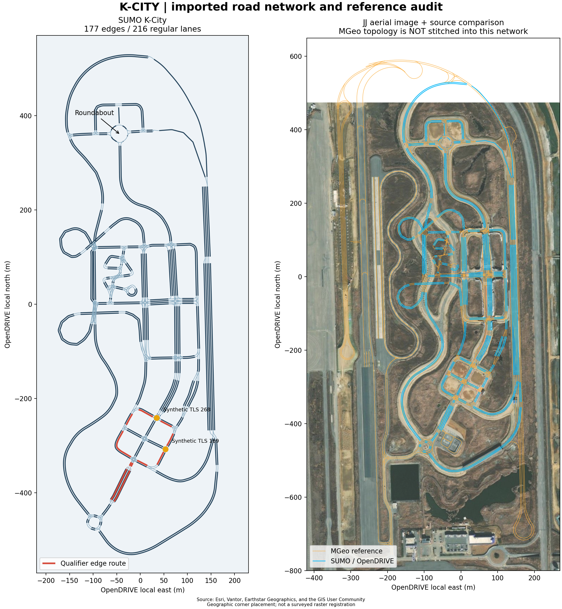

# K-CITY SUMO map

K-CITY의 로컬 OpenDRIVE 원본을 변환한 **도로·교통 데모**다. JJ의 항공사진과 MORAI MGEO를 비교 자료로 사용한다. 학습한 AV 정책은 아직 연결하지 않았다.

## 바로 실행

프로젝트 루트에서 실행한다. 기존 고속도로 예제의 `env/sumo/` 파일을 덮어쓰지 않는다.

```bash
python view_kcity.py                 # SUMO GUI, ▶ 버튼으로 시작
python view_kcity.py --aerial        # JJ 항공사진을 배경으로 표시
python view_kcity.py --netedit       # 도로·차선·Connection 편집기
python view_kcity.py --nogui          # 화면 없이 전체 데모 실행
```

빨간 `demo_ego`는 **SUMO IDM 차량**이다. PPO/BC 또는 HEVEN 주행 스택의 성능을 보여주는 차량이 아니다. 다른 차량은 Krauss / IDM / EIDM / ACC를 순환 배정한 합성 교통이다.

## 두 가지 맵

| 파일 | 용도 |
|---|---|
| `kcity.sumocfg` / `kcity.net.xml` | 검증한 데모: 추정 위치의 신호 2곳 + 비정형 교차로 4곳의 전방향 정지 규칙 |
| `kcity.reference.sumocfg` / `kcity.reference.net.xml` | 원본을 SUMO로 변환한 비교용 맵. 신호·추가 정지 규칙 없음 |

`python view_kcity.py --reference`로 비교용 맵을 열 수 있다. 이 맵의 우선권도 SUMO의 추론 결과이며 실측 교통 규칙이 아니다. 데모의 통과 결과를 비교용 맵에 적용해서는 안 된다.

## 구현 범위와 확인 결과

- 원본 OpenDRIVE: 일반 도로 84개 + 교차로 연결 도로 363개, 교차로 56개.
- SUMO: 일반 Edge 177개, 일반 Lane 216개. 일반 도로 원본 ID 84개 모두 포함.
- 북쪽 회전교차로의 SUMO roundabout 정의, 다차선 도로, 차선별 연결, 높이·곡선·도로 폭 정보.
- 모든 일반 Edge를 대상으로 하는 경로 177개 + CARLA qualifier 기반 데모 경로 1개.
- seed 0/1/2, 각 178대, 최대 1,800초의 종료 조건으로 검사: **534/534대 도착, 충돌·텔레포트 0**.
- 각 seed에서 동시에 최대 33대가 주행했다. 전방향 정지·신호 대기를 포함한 최대 연속 대기는 46.3 / 54.3 / 58.3초였다.
- 급제동 경고 9 / 17 / 19건은 남아 있다. 매끄러운 주행, 모든 부하에서의 안정성, 학습 AV의 Collision Rate를 검증한 결과는 아니다.

상세 한계·필요한 추가 자료는 [구현 보고서](reports/IMPLEMENTATION_REPORT.md)를 참고한다.



## 재생성 및 검증

검증에 사용한 SUMO는 **1.28.0**이다. 실행만 할 때는 SUMO와 bundled Python tools가 있으면 되고, 재생성·분석은 아래 Python 의존성도 필요하다. Gymnasium이나 Torch는 이 맵 도구에서 사용하지 않는다.

```bash
# 필요할 때 별도 가상환경에 설치
python -m pip install -r scripts/kcity/requirements.txt

python scripts/kcity/build.py
python scripts/kcity/audit_sources.py
python scripts/kcity/validate.py --seeds 0 1 2
```

`build.py`는 `source/manifest.json`의 SHA-256을 검사한 뒤 로컬 스냅샷을 입력으로 사용한다. 외부 ROS/CARLA/MORAI 프로세스를 시작하거나 원본 워크스페이스를 수정하지 않는다. 재생성하면 이 디렉터리의 생성된 맵·경로·설정·build 보고서를 갱신한다. 이전 검증 결과는 이전 네트워크 해시를 가리킬 수 있으므로 **재생성 후에는 검증도 다시 실행**한다.

## 파일

| 위치 | 내용 |
|---|---|
| `source/manifest.json` | 원본 위치·역할·해시, 제외한 JJ 기록의 사유 |
| `source/` | 변환 및 비교에 사용한 원본 스냅샷 |
| `kcity.rou.xml` | 178개 경로와 차량 투입 계획 |
| `kcity.junctions.nod.xml` | 데모 전용 전방향 정지 규칙 4곳 |
| `kcity.add.xml` | CARLA의 시작·종료·정지·신호 위치 참고 POI; 정지선 강제 로직은 아님 |
| `kcity.aerial.gui.xml` | JJ 항공사진의 좌표 범위 기반 배경 |
| `reports/build.json` | 도로·연결·신호·경로 대응 및 빌드 명령 |
| `reports/source_audit.json` | 누락 연결 22개 분석, MGEO 비교, JJ GNSS 제외 근거 |
| `reports/validation_kcity.json` | 최종 3개 seed의 정량 검증 |
| `reports/kcity_seed*/` | 차량별 tripinfo, 경고, seed별 결과 |
| `reports/sumo_gui.png` | 실제 SUMO GUI 렌더링 확인 |
| `audit/` | 원본 내부 곡선 변환 경고, 초기 교통 시험과 수정 전 증거 |

## 출처와 사용 범위

OpenDRIVE 원본은 로컬 CARLA K-CITY 자료이며 도로 생성 방법은 [SUMO OpenDRIVE import](https://sumo.dlr.de/docs/Networks/Import/OpenDRIVE.html)를 따른다. 파일이 같다는 사실은 실제 도로의 최신 상태와 일치한다는 증거가 아니다.

JJ 항공사진 출처: **Esri, Vantor, Earthstar Geographics, and the GIS User Community** (`source/jj_kcity.json`). 항공사진은 위경도 범위를 투영한 참고 배경으로, 측량점에 맞춘 정밀 정합 결과가 아니다. MORAI MGEO에는 `license: MORAI`, `data_source: 웨이즈원`이 기록되어 있다. 이번 작업은 로컬 생성이며 외부 업로드·배포를 하지 않았다. 원본 및 파생 맵 공개 시에는 해당 자료의 사용·재배포 조건을 별도로 확인한다.
