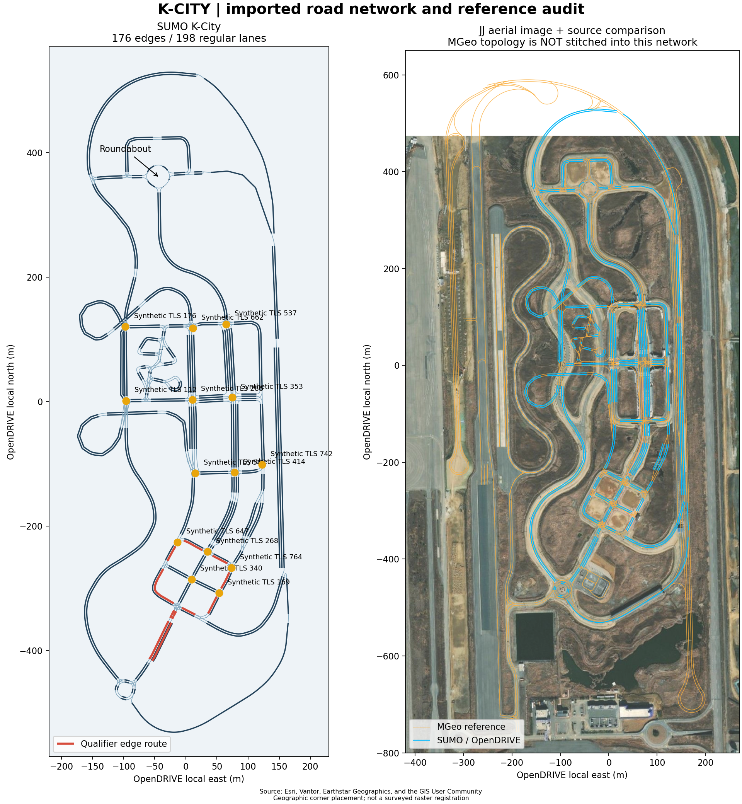

> 신호 구성과 최신 검증 결과는 [신호 설계 보고서](SIGNAL_DESIGN.md)를 우선한다. 아래의 초기 신호 주기·주행 결과는 신호 확대 이전 기록이다. 현재 14개 감응식 제어기, 2개 전방향 정지, 일반 198개/내부 346개 차선이다.

# K-CITY SUMO 구현 보고서

작성 기준: 2026-11-01, 고립 도로 69 제거 후 재검증. 아래 수치는 이 디렉터리의 최종 `build.json`, `source_audit.json`, `validation_kcity.json` 및 seed별 `tripinfo.xml`에서 확인한 결과다. 이후 맵을 재생성하면 보고서의 네트워크 해시와 검증 결과를 함께 갱신해야 한다.

## 1. 현재 완료된 수준

**실행 가능한 K-CITY 도로·교통 시뮬레이션을 구성했다.** 도로 형상, 다차선, 교차로 연결, 회전교차로, 합성 교통, 참고 경로, 항공사진 배경을 포함한다. 제공된 PPO/BC 환경에 연결하거나 모델을 학습한 단계는 아니다.

프로젝트 루트에서:

```bash
python view_kcity.py
python view_kcity.py --aerial
python view_kcity.py --nogui
python view_kcity.py --netedit
```

원본 `heven_jj_2026_ws`, `heven_ad_2026_ws`, CARLA 및 `carla_scenario`의 참조 파일 9개는 복사 전후 SHA-256이 동일하다. ROS/CARLA/MORAI 서버나 실차 노드를 실행하지 않았다. 기존 프로젝트의 고속도로 생성·학습 코드는 변경하지 않았다. `sumo-gui`는 새 검증용 프로세스만 실행하고 종료했다.

## 2. 자료별 채택 여부

| 자료 | 확인 내용 | 사용 방법 |
|---|---|---|
| real-JJ `jj_viz/assets/map/kcity.jpg`, `kcity.json` | K-CITY 항공사진, WGS84 범위와 출처 | SUMO 배경 및 도로 배치 비교 |
| real-JJ `jj_data/path` | 20260912 GNSS 첫 좌표 37.2931633, 126.977774; K-CITY 맵 원점에서 약 18.95 km | K-CITY 경로로 사용하지 않음. 다른 원시 로컬 경로도 약 18 km 동쪽 좌표여서 제외 |
| CARLA canonical `kcity.xodr` | 447 roads, 56 junctions, RoadRunner R2026a; 도로 중심·차선 폭·높이·연결 | **주 도로망 원본** |
| `carla_scenario` qualifier CSV | 499개 점, road/lane ID, CARLA 좌표 | 원본 ID로 대응시킨 SUMO Edge 경로 |
| `carla_scenario` qualifier YAML | 정지·신호·시작·종료 참고 위치 | POI 및 신호 대상 교차로 추정 |
| Team 1 MORAI MGEO | 480 nodes / 634 links, 다른 좌표계·범위·도로 형상 | 같은 투영으로 변환하여 비교; 토폴로지는 병합하지 않음 |

OpenDRIVE SHA-256:

```text
24b6dd916c236891b039cc7aea13390e6c87989c5eff4d7153151efccb24a72b
```

원본별 경로와 모든 해시는 `../source/manifest.json`에 있다. Notion repo hub는 연결 도구에서 404가 반환되어 확인하지 못했다. 이 작업의 데이터 선택은 로컬 파일과 실제 내용에 근거한다.

고립 도로 제거 전 맵·경로·보고서는 `../audit/before_remove_isolated_69/`에 보존했다. 제외 정책은 `build.py`의 `EXCLUDED_SOURCE_ROADS`에 기록했고, 다른 차량의 ID·모델·경로·출발 시각은 유지했다.

## 3. 생성된 도로망

| 항목 | 구현 결과 |
|---|---:|
| 원본 일반 도로 / 교차로 내부 연결 도로 | 84 / 363 |
| 원본 일반 도로 ID 반영 | **83 / 84** — 고립 도로 `69`는 요청에 따라 제외 |
| SUMO 일반 Edge / 일반 Lane | **176 / 198** |
| SUMO 내부 Edge / Lane | 354 / 362 |
| SUMO 일반 Junction 노드 | 66 |
| SUMO roundabout 메타데이터 | 북쪽 1개, 순환 Edge 5개 |
| 합성 신호 프로그램 | 2개 (`169`, `268`) |
| 데모 전용 전방향 정지 규칙 | 4개 (`112`, `176`, `477`, `747`) |
| 일반 도로 Edge를 대상으로 한 검증 경로 | 176개 |
| qualifier 기반 데모 경로 | 1개 |

원본의 road와 SUMO Edge/Junction은 개념이 달라 수량이 일치하지 않는다. 차선 구간별로 도로가 분할되고, 원본 교차로 연결 도로는 SUMO 내부 Edge로 표현된다. 도로 차선 중심선은 0.5 m 해상도로 변환했다.

원본 내부 교차 곡선을 그대로 가져오는 옵션에서는 연결 끝점 간 4~31 m의 형상 간격 경고가 발생했다. 초기 변환본은 도로 차선 형상을 유지하면서 **교차로 내부 곡선을 SUMO가 다시 생성**하도록 했다. 따라서 내부 회전 경로의 정밀 복제는 아니다. 원래 옵션의 경고는 `../audit/import_warnings.log`에 보존했다.

일반 미사용 차선 17개와 회전 연결 53개를 제거했다. 원본 내부 차선 56개가 삭제 대상이었고, 연결 분할 지점 재계산으로 내부 차선은 총 419→362개가 됐다. 이 과정에서 내부 분할 차선 수가 추가로 1개 줄었다. 원본 road ID 42개가 의도적으로 추가 제외됐으며, 아래의 원래 import 누락 22개와 구분한다. 삭제 전 맵은 `../audit/before_remove_unused_lanes/`에 보존했다.

차선 삭제 후 netconvert가 36개 일반 차선의 배치·교차로 접속부 형상을 재계산했다. 원본 차선 ID 대응은 보존했지만 좌표가 전부 동일한 단순 삭제본은 아니다. 전후 형상과 인덱스 대응은 `../audit/pruning_kcity.net/report.json`에 있다.

## 4. 좌표와 경로 대응

- OpenDRIVE 기준: `+proj=tmerc +lat_0=37.24273 +lon_0=126.77363 +k=1 ...`.
- SUMO 좌표 정규화를 끄고 OpenDRIVE 로컬 좌표를 유지했다.
- CARLA CSV·참고 위치는 `(x, y) -> (x, -y)`로 변환했다.
- 삭제 전 qualifier CSV 499개 점 모두 원본 road/lane ID에 대응시켰다. 삭제 대상 차선에 대응했던 38개 점은 원본 참고 기록으로 남겼으며, 현재 SUMO 차량의 차선 강제 조건으로 사용하지 않는다. 경로 사이에서 빠진 0.2 m짜리 Edge `-3#7`, `3#7`을 실제 연결을 따라 보충했다.
- CSV와 SUMO 차선의 최근접 거리는 최대 약 8.25 m였다. 교차로 재구성·차선 끝점 잘림의 영향을 포함하며, **499개 점의 정확한 궤적 재현을 검증한 것은 아니다.** 현재 차량은 대응된 Edge 경로를 SUMO의 주행 모델로 따라간다.
- MGEO는 UTM 52N 좌표와 원점을 사용해 같은 투영으로 변환했다. MGEO에서 약 2 m 간격으로 추출한 19,089점과 0.5 m 이하 간격의 SUMO 차선 표본을 비교했을 때 중앙 거리 약 **3.68 m**, 90백분위 **150.83 m**, 5 m 이내 비율 **53.3%**였다.
- 이 수치는 두 맵의 범위·형상·좌표 정합 차이가 함께 들어간 비교이며 측량 정확도나 동일 차선 오차가 아니다. 특히 MGEO에만 있는 서쪽 직선 구간과 외곽 선형을 현재 맵에 억지로 연결하지 않았다.



## 5. 신호·교통의 가정

OpenDRIVE 원본에는 `signal`, `controller`, `object`가 모두 **0개**다. 실제 신호등 주기나 표지판을 복원할 수 있는 원본이 아니다.

- qualifier의 `Q_SIGNAL1`, `Q_SIGNAL2` 위치에서 가장 가까운 다방향 교차로를 선택했다. 노드까지 거리는 약 13.47 m / 10.71 m다. 이를 신호 위치의 최종 확정으로 보지 않는다.
- 두 신호는 각각 **녹색 20초, 황색 3초, 전적색 2초 × 2방향 = 50초 주기**의 SUMO 생성 프로그램이다. 실제 신호 운영 자료가 아니다.
- 초기 기본 우선권 맵의 seed 2에서 교차로 `176`의 차량 간 충돌을 확인했다. 데모는 변환기가 방향 판정을 모호하다고 경고한 비정형 교차로 4곳에 `allway_stop`을 설정했다. **실제 K-CITY에 해당 정지 표지가 있다는 뜻이 아니다.** 추가 신호·정지 규칙이 없는 비교용 맵은 `kcity.reference.net.xml`이며, 요청한 차선 삭제는 이 맵에도 적용했다.
- 원본의 속도 항목은 모두 **40 mph(약 64.37 km/h)**이다. 실제 구간별 제한속도로 신뢰하지 않고, 데모 차량의 최대속도를 8.33 m/s(약 30 km/h)로 설정했다.
- 기존 177대 일반 차량 계획에서 고립 도로용 1대를 제외한 176대를 투입하고 10초에 빨간 `demo_ego` 1대를 추가한다. 진입 수요 약 600대/시간에 해당하는 **유한 합성 교통**이며, 실제 교통량을 모사한 값은 아니다.
- `demo_ego`는 IDM, 일반 차량은 Krauss / IDM / EIDM / ACC다. 학습 정책·실차 제어기·ROS 스택은 사용하지 않는다.

## 6. 실제 실행 검증

SUMO 1.28.0, `step-length=0.1`, 교차로 충돌 검사 활성화, `time-to-teleport=-1`로 검사했다. 차량을 텔레포트시켜 막힘을 숨기지 않았다. 충돌은 제거하지 않고 경고·TraCI 이벤트로 기록했다. 모든 차량 도착 시 조기 종료하며, 최대 1,800초로 제한했다.

| Seed | 출발 / 도착 | 충돌 / 텔레포트 | 최대 동시 차량 | 최대 연속 대기 | 급제동 경고 | 종료 시뮬레이션 시각 |
|---|---|---|---:|---:|---:|---:|
| 0 | 177 / 177 | 0 / 0 | 33 | 61.3초 | 10 | 1277.6초 |
| 1 | 177 / 177 | 0 / 0 | 33 | 64.3초 | 15 | 1277.6초 |
| 2 | 177 / 177 | 0 / 0 | 33 | 59.3초 | 17 | 1277.7초 |

- **합계 531/531대 도착**, 빨간 demo 차량도 3회 모두 도착했다.
- 모든 seed에서 176개 일반 Edge 각각을 포함하는 대응 경로의 차량이 도착했다. 1초 간격 점유 표본은 짧은 Edge를 놓칠 수 있으므로, 전체 Edge 검증은 표본 점유 개수가 아닌 **대상 경로의 완주**를 근거로 한다.
- 1초 표본에서 같은 Edge 안의 차선 인덱스 변화는 seed별 31 / 30 / 34회 관측했다. 정확한 전체 차선변경 이벤트 수는 아니다.
- GUI에서도 60초를 실행하고 차량 12대가 있는 맵을 항공사진 배경과 함께 렌더링했다. `sumo_gui.png`, `gui_check.json`에 결과가 있다.
- 초기 3초 간격의 높은 투입량에서는 충돌 없이 모두 도착했지만 연속 대기가 최대 375.6초였다. 최종 기본값은 6초 간격이며, 고부하 교통의 정체 문제를 해결했다고 주장하지 않는다.

검증의 `passed`는 경로 연결·종료·충돌·텔레포트 조건에 대한 결과다. **급제동·승차감, 실제 우선권 정확성, 100 Episode 이상의 AV 성능 평가, 모든 교통량에서의 안정성을 보증하지 않는다.**

## 7. 부족한 부분과 필요한 추가 정보

| 우선순위 | 부족한 부분 / 확인된 사실 | 필요한 정보 또는 다음 작업 |
|---|---|---|
| 높음 | 원본 교차로 연결 도로 ID 22개가 최종 내부 Edge의 origId에 직접 남지 않음 | `source_audit.json`의 목록별 방향·laneLink·교차로 도면 확인. 2개는 같은 차선 연결이 다른 ID로 보존되었고, 나머지 20개는 연결 대응이 확인되지 않음 |
| 높음 | `bidirectional` 차선이 있는 구간에서 역방향 연결 의미가 불명확 | 도로별 실제 통행 방향, 양방향 공용/일방향/가변차로 여부와 운용 규칙. SUMO가 현재 생성한 방향을 현장 사실로 간주하지 말 것 |
| 처리 완료 | 고립된 Edge `69` | 사용자 요청으로 데모·비교용 맵 및 해당 경로·차량에서 제거. 원본 스냅샷은 보존. 재생성 시에도 제외하며, 남은 176개 Edge는 하나의 약연결 성분임 |
| 높음 | 신호·우선권은 데모용 가정 | 실제 신호등 위치, 제어 차로/진행 방향, 정지선, 현시 순서·주기·offset, 비보호 회전과 교차로 우선권 |
| 중간 | MGEO 외곽과 OpenDRIVE 범위가 다름 | 같은 버전의 전체 K-CITY OpenDRIVE 또는 원본 MGEO 전체 세트, 기준점/좌표 변환 근거. 특히 서쪽 및 외곽 누락 구간의 연결 확인 |
| 중간 | 실제 도로 속도·차종·수요 미반영 | 구간별 제한속도, 통행 제한, 유입 방향별 교통량 및 차량 유형 비율 |
| 중간 | 기존 Q_STOP1/Q_STOP2는 POI만 표시 | 정확한 정지선과 적용 차선. 현재 표시 위치에서 3초 정지를 강제하는 대회 미션 로직은 미구현 |
| 중간 | 일부 급격한 곡선·연결 경고와 급제동 잔존 | `audit/demo_warnings.log`와 seed별 경고 위치의 도로 형상·연결 검수, 차량 모델 및 교차로 설정 개선 |
| 후속 | 학습 AV와 데이터셋 미연결 | 여러 Edge/분기/교차 차량을 처리하는 Gym 환경, Observation·Action·Reward·목적지 판정, 모델 학습 및 평가·수집 구성 |

연결 미대응 원본 road ID 20개:

```text
234, 238, 267, 595, 597, 598, 599, 601, 602,
606, 607, 608, 610, 611, 612, 613, 654, 739, 854, 855
```

같은 연결이 다른 ID로 유지된 2개는 `424`, `433`이다. 일반 도로 일부 차선에 들어오는 연결이 없다는 경고 5개도 남아 있다: `-3#2_0`, `-36#1_1`, `-41_0`, `3#6_0`, `66_1`. 일부는 차선 추가 구간일 수 있으므로, 근거 없이 Connection을 추가하지 않았다.

지금 결과물은 **도로 선택과 상호작용 설계를 시작하고 SUMO에서 교통을 실행할 수 있는 기반**이다. 다음 단계에서는 사용할 회전교차로·합류·신호교차로 구간을 정하고, 그 구간의 방향·연결·교통 규칙부터 확정한 뒤 학습 환경을 연결하는 것이 적절하다.
