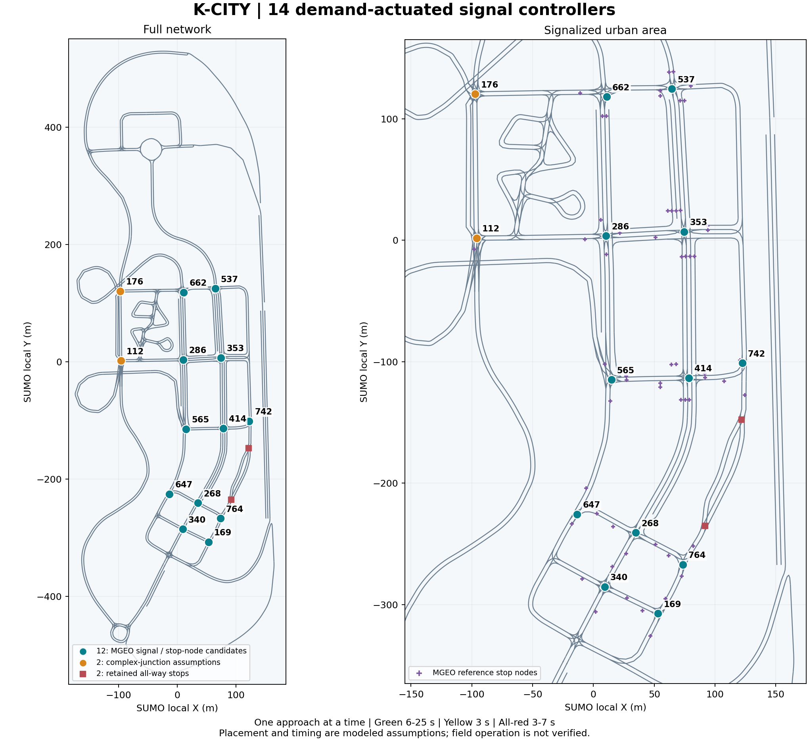

# K-CITY 신호 배치·운영 및 교통 검증

## 적용 결과

기존 2개 임시 신호를 **14개 교차로의 수요 감응식 제어기**로 확대했다. 신호등 기둥/등기구 14개라는 뜻은 아니다. 각 교차로의 진입 차선과 진행 방향을 함께 제어한다. MGEO·CARLA 자료와 명시적인 교통공학 가정을 사용한 시뮬레이션이며 **실제 현장 신호 운영과 동일하다고 검증한 결과는 아니다.**



- 청록색 12곳: MGEO 신호 ID를 가진 정지 노드와 SUMO 진입 차선 끝점이 20m 이내에서 대응하는 후보.
- 주황색 2곳: 복잡한 5지 교차로 `112`, `176`. `112`에는 MGEO 후보 1개가 있지만, 두 곳 모두 복잡한 교차 흐름과 이전 충돌을 근거로 신호 제어를 선택했다.
- 적색 사각형 2곳: `477`, `747`의 기존 합성 전방향 정지 규칙 유지.
- 북쪽 회전교차로와 좁고 짧은 내부 골목은 신호를 추가하지 않았다. 정지선 표시만으로 모든 교차로를 신호화하지 않았다.

## 배치 근거

| 교차로 ID | 위치 X,Y(m) | 20m 이내 MGEO 신호 정지 노드 수 | 진입 방향 수 | 전적색 범위(초) |
|---|---|---:|---:|---:|
| `537` | 64.6, 124.6 | 7 | 4 | 3–4 |
| `176` | -97.3, 120.4 | 0 | 5 | 3–4 |
| `662` | 10.9, 118.1 | 4 | 4 | 4–4 |
| `353` | 74.5, 6.9 | 11 | 4 | 4–5 |
| `286` | 10.3, 3.5 | 4 | 4 | 4–4 |
| `112` | -96.1, 1.7 | 1 | 5 | 7–7 |
| `742` | 122.4, -101.2 | 3 | 3 | 4–4 |
| `414` | 78.4, -113.4 | 9 | 4 | 3–4 |
| `565` | 14.8, -114.8 | 4 | 4 | 6–7 |
| `647` | -13.4, -225.6 | 3 | 3 | 4–4 |
| `268` | 34.9, -240.7 | 3 | 4 | 3–3 |
| `764` | 73.5, -267.0 | 3 | 3 | 3–3 |
| `340` | 9.2, -285.2 | 4 | 4 | 3–3 |
| `169` | 53.1, -307.3 | 3 | 3 | 3–3 |

좌표는 현재 SUMO/OpenDRIVE 로컬 좌표다. MGEO는 UTM 원점과 투영을 변환한 뒤 진입 차선 끝점에 대응시켰다. **20m 근접은 위치 후보 선정 규칙이며, 실제 정지선이나 동일 차선의 정밀 정합을 보증하지 않는다.** 따라서 정지선을 MGEO 점으로 억지로 옮기지 않고 현재 SUMO 진입 차선 끝을 사용했다. 기존 도로의 진출입 연결·일반 차선 형상·속성은 바꾸지 않았음을 빌드에서 검사한다.

현재 입력에 있는 MGEO는 정지 노드 150개, 신호 ID가 있는 노드 73개이며 둘은 교차로 개수가 아니다. 링크의 직진·좌회전·비보호 속성은 참고했지만 다른 맵 버전의 회전 연결을 SUMO에 추가하지 않았다. `global_info.json`에는 원래 `traffic_light_set.json`, `intersection_controller_data.json` 등의 해시가 있으나 해당 파일들은 현재 입력에 없고 로컬 검색에서도 찾지 못했다.

CARLA qualifier에는 신호 액터 두 곳의 좌표와 정지 후 녹색으로 전환하는 대회 규칙이 있다. 현재의 교차로 `268`, `169`와 대조했다. 원본 OpenDRIVE의 signal/controller 정의는 0개다. CARLA 서버 2000 포트가 열려 있지 않아 현재 액터의 신호 그룹/시간은 조회하지 않았다. 과거 기록의 7개 액터를 현재 배치의 확정 근거로 사용하지 않았다. MORAI 저장본의 `tlList`도 상태 스냅샷이며 전체 주기표로 해석하지 않았다.

## 운영 규칙과 가정

- 한 번에 한 진입 방향을 허용하는 분리 현시. 같은 차선의 직진/좌회전 신호가 엇갈려 선두 차량이 뒤 차량을 막는 상황을 피하도록 함께 제어한다.
- 녹색 **최소 6초, 최대 25초**. 감지기 통과 간격 3초를 기준으로 연장한다.
- 녹색 뒤 **황색 3초 → 전적색 3–7초**를 반드시 거친다. 전적색은 해당 방향에서 가장 오래 걸리는 내부 경로의 `구간 길이 / min(차량 최고속도 8.33m/s, 구간 속도)` 합과 차량 길이 4.5m의 후미 통과 시간을 올림해 산정했다. 현장 실측값은 아니다.
- 전적색 이후 감지 수요를 비교해 다음 녹색 방향을 선택한다. 차량이 없는 방향은 건너뛸 수 있다. 60초 동안 서비스되지 않은 감지 수요에 가중치를 주어 장시간 대기를 줄인다. **60초가 최대 차량 대기시간이라는 뜻은 아니다.**
- 모든 방향이 적색일 때도 서로 충돌하는 녹색을 생략해 바로 켜지 않도록 전환 경로를 검사한다.
- 적색 중 우회전은 허용하지 않았다. 보행자·횡단보도 동시 운영과 현장 우회전 조건을 아직 재현하지 않았기 때문이다.
- 현재 프로그램은 독립 감응식이다. 고정 주기·주도로 녹색 연동(그린웨이브)을 실측 복원한 것이 아니다.
- 30km/h 수준의 현재 데모 차량 설정을 기준으로 설계했다. 차량 속도·길이·수요를 크게 바꾸면 전적색과 교통 검증도 다시 해야 한다.

SUMO 구현은 [Traffic Lights 공식 문서](https://sumo.dlr.de/docs/Simulation/Traffic_Lights.html)의 감응식 제어·동적 현시 선택·추가 프로그램 정의를 사용한다. 프로그램은 `../kcity.signals.add.xml`이며 기본 `.sumocfg`에서 로드한다. 네트워크 단독 로드 시 netconvert 기본 프로그램이 사용될 수 있으므로 실행은 `python view_kcity.py` 또는 `kcity.sumocfg`로 한다.

## 실행 검증

SUMO 1.28.0, 0.1초 간격, 교차로 충돌 검사 활성화, 텔레포트 비활성화. 기존/신규 구성에 같은 차량·경로·시드·투입 시각을 적용했다. 각 시험은 177대의 유한 수요이며 최대 3,600초, 3개 시드(0/1/2)다. 2배/3배는 차량 총수를 늘린 것이 아니라 투입 간격을 줄였다. 무작위 OD는 300–1,500m 최단 경로를 별도로 만들었고 실제 교통 OD 조사는 아니다.

| 수요 | 도착 / 투입 | 충돌 / 텔레포트 | 평균 누적 정지시간(초/대) | 최대 관측 대기행렬(m) |
|---|---:|---:|---:|---:|
| 기본 투입(6초 간격) | 531 / 531 | 0 / 0 | 55.6 | 53.0 |
| 2배 투입(3초 간격) | 531 / 531 | 0 / 0 | 103.9 | 68.5 |
| 3배 투입(2초 간격) | 531 / 531 | 0 / 0 | 136.2 | 99.2 |
| 별도 무작위 OD 경로(6초 간격) | 531 / 531 | 0 / 0 | 20.9 | 33.0 |

**최종 12개 시험, 2,124/2,124대 도착, 충돌·텔레포트·미완주 0.** 대기행렬은 5초 간격 표본에서의 최댓값이며 연속시간 최댓값은 아니다. 실제 현장의 교통량, 지속적인 포화 수요, 대형차·보행자와의 상호작용은 검증하지 않았다.

기존 2개 신호 구성은 같은 12개 시험 중 4개에서 충돌이 있었다(교차로 112/176). 다만 신호가 훨씬 적었던 기존 기본 수요의 평균 누적 정지시간은 약 8.8초로, 신규 구성의 약 55.6초보다 짧았다. 이번 변경은 모든 상황의 소요시간을 줄였다는 결과가 아니다. 신호 준수와 충돌 억제에 따른 정지시간 증가를 포함한다.

첫 설계의 순차 감응 현시에서는 기본 수요 평균 정지 약 118.7초, 3배 투입 1건에서 교착이 있었다. 최종 수요 기반 현시 선택에서 이 문제가 관측되지 않았고 기본 평균 정지는 약 55.6초로 줄었다. 첫 설계 결과는 `signals_validation_v1/`에 남겼다.

별도 TraCI 기본 주행 검사에서도 531/531대가 도착했고, 14개 제어기 모두 `assumed_actuated_v1` 프로그램을 실제 사용하며 녹색·황색·적색을 전환했음을 확인했다. 기본 시드별 급제동 경고는 7/9/6건 남는다. 신호 프로그램 검사는 충돌 녹색 없음, 모든 연결 서비스, 공유 차선의 신호 일치, 황색/전적색 전환 강제를 포함한다.

신호화에 따른 교차로 내부 분할 재계산으로 내부 차선은 362→346개가 됐다. 일반 Edge 176개/일반 Lane 198개 및 차량 투입 파일은 이전과 동일하다. 최종 일반 차선 198개와 내부 차선 346개 모두 기본 3개 시드 중 최소 한 번 통행했다. 실제 GUI에서도 120초까지 실행해 제어기 14곳 모두 새 프로그램을 사용하는 것을 확인했고, 화면은 `sumo_gui.png`와 `sumo_signals_gui.png`에 저장했다.

## 재현·복구·추가 자료

- `../signal_policy.json`: 선정 교차로와 운영 가정.
- `signal_design.json`: 노드별 MGEO 후보, 거리, 제어 방향, 전적색 산정, 입력 한계.
- `signals_validation/summary.json`: 기존/신규 비교 24개 실행의 결과. 신규는 12개 실행이다.
- `validation_kcity.json`: 기본 주행 TraCI 검사와 활성 프로그램 기록.
- `../audit/before_signal_design/`: 변경 전 맵·설정·보고서·빌드 스크립트 백업.
- `../kcity.reference.sumocfg`: 추가 신호가 없는 비교용 맵. 기본 데모와 같은 검증 결과를 보장하지 않는다.

```bash
python scripts/kcity/build.py
python scripts/kcity/audit_sources.py
python scripts/kcity/render_signals.py
python scripts/kcity/validate_signals.py
python scripts/kcity/validate.py --seeds 0 1 2
python scripts/kcity/lane_usage.py
python view_kcity.py --aerial
```

현장 운영과 동일한 재현에는 **교차로별 신호현시표(방향별 허용 조합·시간), 신호 그룹–차로 대응, 정밀 정지선 위치, 실제 시간대별 교통량/OD**가 필요하다. 차량 검지·신호 연동 자료와 보행자 현시가 있으면 그 부분도 보완할 수 있다. 현재의 14개 배치는 이러한 자료가 없는 상태에서 근거와 가정을 구분한 실행 가능한 모델이다.
