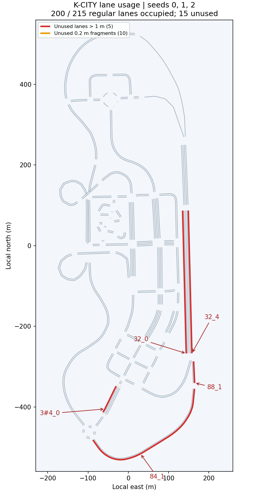

> 이 문서는 삭제 전 215개 일반 차선 기준의 역사적 검사다. 현재 결과는 [삭제 보고서](../LANE_PRUNING.md)와 `../lane_usage_after_pruning/summary.json`을 참고한다.

# K-CITY 차선 사용 조사

현재 맵·경로를 변경하지 않고 seed 0/1/2를 각각 1,800초 실행했다. 각 실행에서 177대가 도착했다. SUMO laneData로 매 시뮬레이션 스텝의 차선별 점유 시간과 진입·진출·차선변경 이벤트를 수집했다.

**일반 차선 215개 중 200개는 사용 기록이 있고, 15개는 세 seed 모두 점유·진입·진출·차선변경 이벤트가 0이다.** 교차로 내부 차선은 별도이며 419개 중 363개에 점유 기록이 있다.

도로 Edge 176개 완주 검증은 모든 개별 Lane의 사용을 의미하지 않는다. 점유 기록 역시 차선의 처음부터 끝까지 통과했다는 증거는 아니다. 예를 들어 66_1은 진입·진출 Connection이 모두 없지만 짧은 차선변경 점유가 관측되었다.

| 미사용 차선 | 길이(m) | 진입 Connection | 진출 Connection |
|---|---:|---:|---:|
| `-3#2_0` | 0.20 | 0 | 1 |
| `-3#3_0` | 0.20 | 2 | 1 |
| `-3#5_0` | 0.20 | 2 | 1 |
| `-3#6_0` | 0.20 | 2 | 0 |
| `-36#1_1` | 0.20 | 0 | 1 |
| `3#1_0` | 0.20 | 2 | 0 |
| `3#2_0` | 0.20 | 2 | 1 |
| `3#3_0` | 0.20 | 2 | 1 |
| `3#4_0` | 72.94 | 2 | 1 |
| `3#5_0` | 0.20 | 2 | 1 |
| `3#6_0` | 0.20 | 0 | 1 |
| `32_0` | 354.41 | 2 | 0 |
| `32_4` | 354.41 | 0 | 0 |
| `84_1` | 359.71 | 2 | 0 |
| `88_1` | 53.68 | 2 | 1 |

Connection은 차선 사이의 종방향 연결 수다. 같은 Edge 안의 차선변경 가능성까지 나타내는 값은 아니다. 32_4처럼 양쪽 연결이 없는 차선은 추가 점검 대상이며, 이를 곧바로 완전 고립 차선이라고 단정하지 않는다. 32_0·84_1의 진출 연결 부재도 다른 차선으로 이동해 나가는 도로 설계인지 확인해야 한다.

일반 차선 중 미사용인 것은 72.94~359.71 m 차선 5개와 길이 0.2 m의 변환 구간 10개다. 현재 교통에서 미사용이라는 사실만으로 해당 차선을 삭제하지 않았다.

[원시 집계](summary.json) · [측정 항목 설명](https://sumo.dlr.de/docs/Simulation/Output/Lane-_or_Edge-based_Traffic_Measures.html)

Network SHA-256: `6a5704f3711fdb243ab0bb8245c7c4fc03e42cb2d7d820f0fe9523a3e14baeae`
Routes SHA-256: `dfb35f886fa2b5b669109122e50666e1a784d47e938cdbf0fd817e429756a2db`
